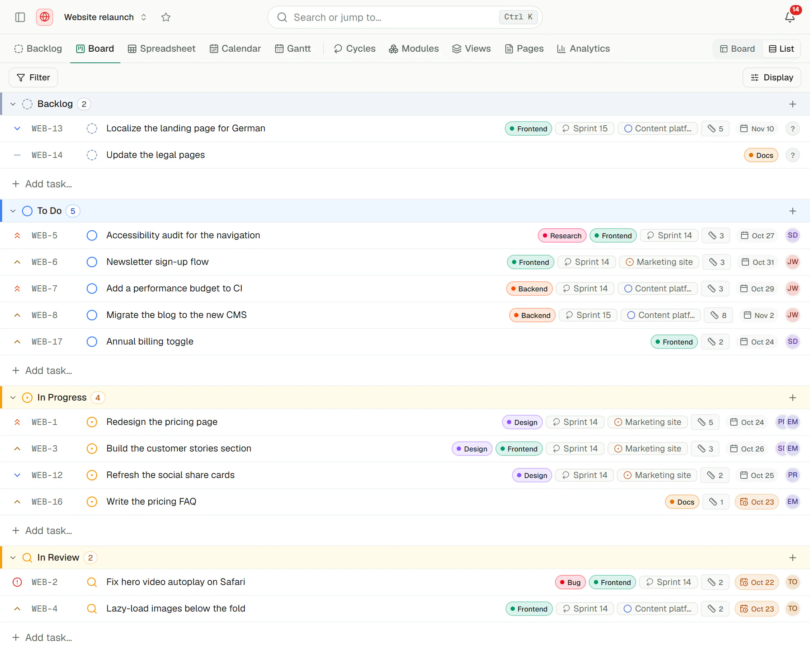
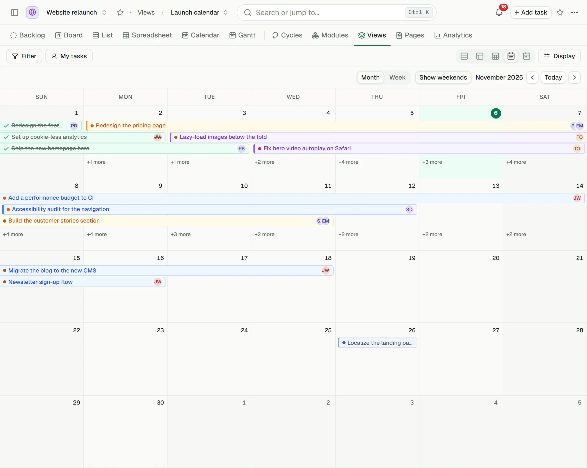
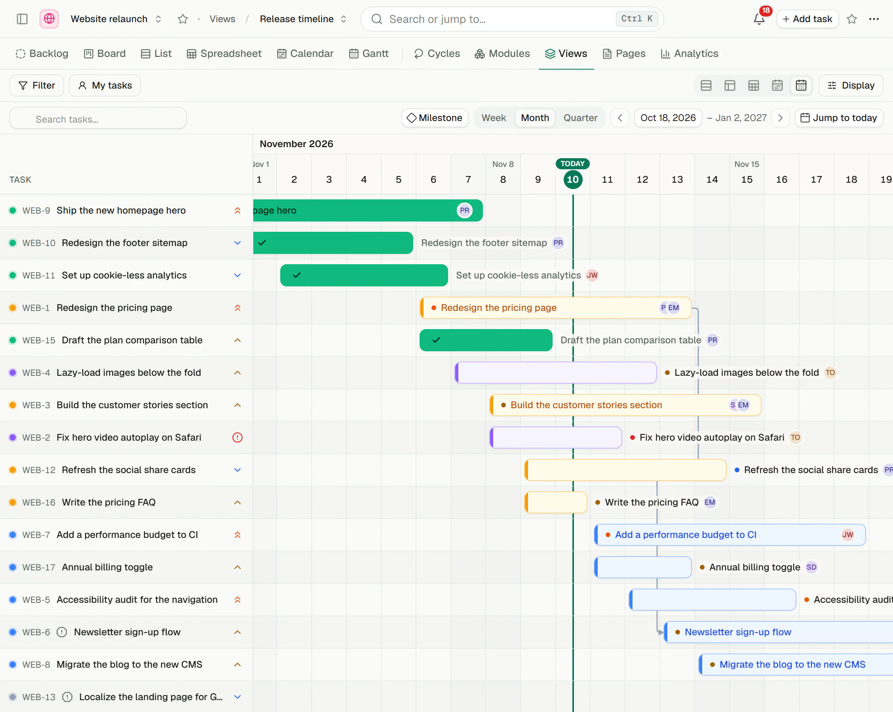
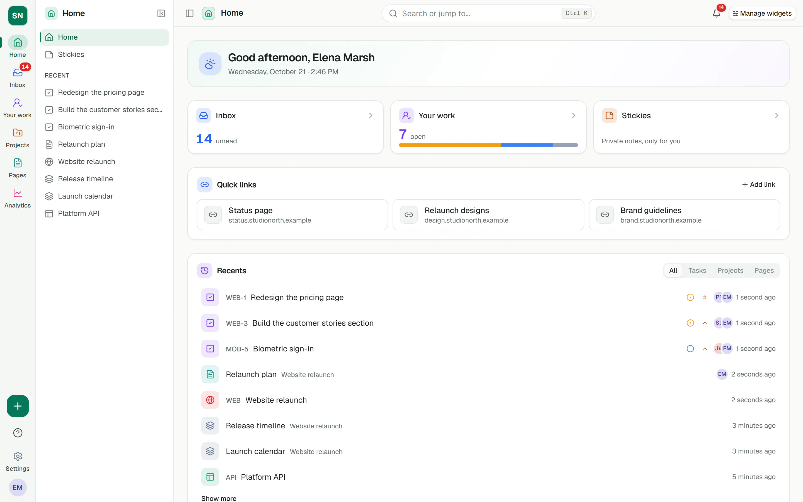
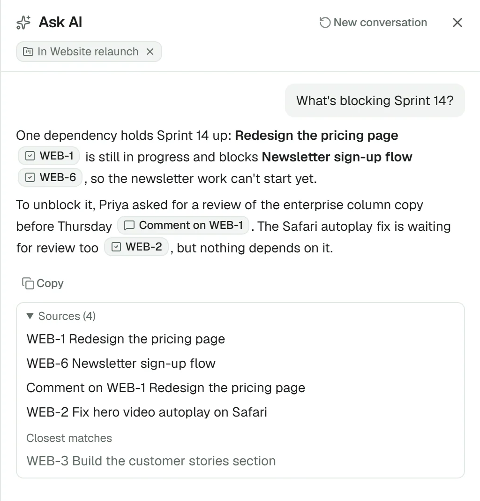
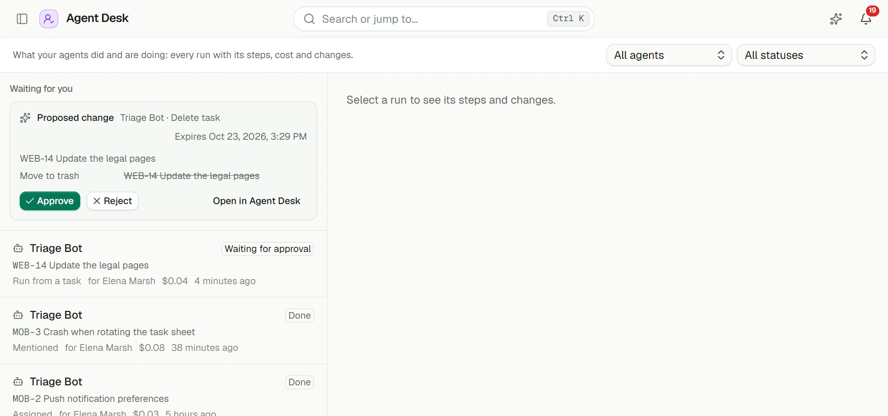

<p align="center">
  <picture>
    <source media="(prefers-color-scheme: dark)" srcset="apps/web/public/logo-light.svg" />
    
  </picture>
</p>

<div align="center">

[](LICENSE)
[](https://github.com/manu14357/Margaya/actions)

</div>

<div align="center">
  <h3>
    <a href="https://margaya.app/docs/core">Quick Start</a>
    <span> | </span>
    <a href="https://margaya.app">Website</a>
  </h3>
</div>

https://github.com/user-attachments/assets/5d15c041-68a9-4cf4-b82b-dcc7454fe3a2

<p align="center">
  <sub>▶️ A quick tour of Margaya.</sub>
</p>

## What is Margaya?

Margaya is a fast, self-hosted project management platform. Your team plans, tracks and ships work in one place, and your data stays on your own server.

It is simple by default. Extra planning tools are there when you need them and out of the way when you don't.

Free and open source under the MIT license.

## Features

### Plan and track work

- **Workspaces and projects** to organise teams and work
- **Boards** with your own columns (statuses), plus a **list / backlog** view
- **Tasks** with priorities, labels, due and start dates, multiple assignees, subtasks and links between tasks
- **Custom fields** for anything else you want to track
- **Time tracking** on every task
- **Task templates**, **repeating tasks** and **private drafts**
- **Description history**: see and restore earlier versions of a task description
- **Comments, mentions and reactions**

### Views

- **List, Board, Spreadsheet, Calendar and Gantt** layouts
- Filter, group and **save views**, for one project or across all projects
- **Your work**: everything assigned to you, created by you or watched by you
- **Home** with widgets, quick links and private sticky notes

### Planning tools (turn on only what you need)

- **Cycles**: time-boxed sprints with burndown and carryover
- **Modules**: track a bigger feature across many tasks
- **Estimates**: points, sizes or time
- **Intake**: a review queue for incoming requests
- **Pages**: docs and specs next to your tasks, edited together live, with version history
- **Analytics**: open, created and completed work, with CSV export
- **Forecast and risk**: when work will likely finish and what could make it slip

### Automation

- **Rules**: "When → If → Then" automations on task changes
- **Project housekeeping**: auto-archive closed tasks, close stale ones, roll unfinished cycle work over
- **Archive, trash and restore**

### AI (optional, off by default)

Works with Claude, or with your own local model through any OpenAI-compatible server (Ollama, vLLM and others).

- **Ask AI**: ask questions about your workspace and get answers that cite the tasks and pages they came from
- **Build mode**: ask the AI to make changes, review them as cards, confirm, and undo any of them
- **Voice mode**: talk to Ask and Build, and hear the answer read back
- **Build with AI**: describe a plan in one sentence and get a project with cycles, modules and tasks
- **AI writing**: rewrite, shorten, translate or summarise text in tasks, comments and pages
- **Triage and briefs**: suggestions for new tasks, translation of comments, and cited stakeholder briefs
- **My brief**: an opt-in daily note with what is due, blocked and new for you
- **AI agents**: delegate work to agents that act with at most your rights; review, approve and undo their changes
- **Coding agents**: send a task to Claude Code, GitHub Copilot or Codex as an issue, and follow the pull request back
- **Skills and memory**: teach the AI your team's way of working
- **Privacy controls**: choose what may leave your server, or keep everything local

### Notifications and sharing

- **Inbox** with snooze and archive, plus email notifications and digests
- **Realtime updates**: everyone sees changes instantly
- **Public boards and pages**: share a project or page with anyone, with moderated comments

### Integrations

- **GitHub** and **Gitea**: connect repositories and keep issues and pull requests in sync with tasks
- **Slack, Discord, Mattermost and Telegram** notifications
- **Webhooks**: send workspace events to your own services as signed requests
- **MCP server**: let AI tools like Claude and Cursor manage your tasks
- **A2A**: let other AI agents work with Margaya
- **REST API** with OpenAPI docs and scoped API keys

### Import and export

- Import from **Jira, Asana, Linear, Trello** or a **CSV** file
- Export tasks from some or all projects

### Security and admin

- Sign in with email and password, a magic link, **GitHub, Google, Discord** or your own OAuth / OIDC provider
- **Two-factor authentication** and a sign-in policy for the whole instance
- **Roles and permissions**, plus **restricted projects** for chosen members only
- **Audit log** of important changes
- Safe **workspace deletion** with a grace period
- An **instance admin** area for server-wide settings

### For everyone

- **20 languages**
- Light, dark and high-contrast themes
- **Keyboard shortcuts** for everything common

## Screenshots

<table>
  <tr>
    <td width="50%" align="center">
      <br />
      <sub><b>List</b> — group, sort and filter your tasks</sub>
    </td>
    <td width="50%" align="center">
      <br />
      <sub><b>Calendar</b> — see due and start dates at a glance</sub>
    </td>
  </tr>
  <tr>
    <td width="50%" align="center">
      <br />
      <sub><b>Timeline</b> — a Gantt view of the plan</sub>
    </td>
    <td width="50%" align="center">
      <br />
      <sub><b>Home</b> — widgets, quick links and sticky notes</sub>
    </td>
  </tr>
  <tr>
    <td width="50%" align="center">
      <br />
      <sub><b>Ask AI</b> — answers that cite your tasks and pages</sub>
    </td>
    <td width="50%" align="center">
      <br />
      <sub><b>AI agents</b> — delegate work, then review and undo</sub>
    </td>
  </tr>
</table>

## Getting Started

### Quick Start with Docker Compose

The fastest way to try Margaya: one Margaya container plus PostgreSQL.

```yaml
services:
  postgres:
    image: postgres:16-alpine
    env_file:
      - .env
    environment:
      POSTGRES_USER: ${POSTGRES_USER:-margaya}
      POSTGRES_DB: ${POSTGRES_DB:-margaya}
    volumes:
      - postgres_data:/var/lib/postgresql/data
    restart: unless-stopped
    healthcheck:
      test: ["CMD-SHELL", 'pg_isready -U "$${POSTGRES_USER}" -d "$${POSTGRES_DB}"']
      interval: 10s
      timeout: 5s
      retries: 5

  margaya:
    image: ghcr.io/manu14357/margaya:latest
    ports:
      - "5173:5173"
    env_file:
      - .env
    depends_on:
      postgres:
        condition: service_healthy
    restart: unless-stopped

volumes:
  postgres_data:
```

1. Save this as `compose.yml`.
2. Copy `.env.sample` to `.env`.
3. In `.env`, uncomment `MARGAYA_CLIENT_URL=http://localhost:5173`, and set `POSTGRES_PASSWORD=<password>` and `AUTH_SECRET=<output of openssl rand -hex 32>`.
4. Run `docker compose up -d`.
5. Open [http://localhost:5173](http://localhost:5173).

Inside Docker Compose, Margaya reaches PostgreSQL at the hostname `postgres`, and the database is not exposed outside the Compose network. If you run the API on your host for development, add a loopback-only mapping (`127.0.0.1:5432:5432`) and set `DATABASE_URL` to match.

### What you need

- **Required:** PostgreSQL.
- **Optional:** Redis, only when you run more than one API instance.
- **Optional:** S3-compatible storage for uploads. A built-in file store is used otherwise.
- **Optional:** pgvector, for AI semantic search.

### Other ways to deploy

- **Kubernetes:** use the [Helm chart](./charts/margaya/README.md).
- **Separate API and web:** use the `ghcr.io/manu14357/api` and `ghcr.io/manu14357/web` images.

See the [documentation](https://margaya.app/docs/core) for every environment variable, reverse proxy examples and troubleshooting.

## MCP Server

Every Margaya instance has a built-in MCP endpoint at `/api/mcp`, so AI tools like Claude and Cursor can manage your tasks, projects and labels. For stdio clients, use the [@margaya/mcp](https://www.npmjs.com/package/@margaya/mcp) package: `npx -y @margaya/mcp`.

See the [MCP guide](https://margaya.app/docs/core/integrations/mcp).

## Development

```bash
git clone https://github.com/manu14357/Margaya.git
cd Margaya
pnpm install

# Create a .env file in the root (see ENVIRONMENT_SETUP.md)

pnpm dev
```

You need Node.js 24 or newer and pnpm 10. See the [Environment Setup Guide](ENVIRONMENT_SETUP.md) for details and fixes for common problems, such as CORS.

## Community

- **[GitHub Issues](https://github.com/manu14357/Margaya/issues)**: bug reports and feature requests
- **[Documentation](https://margaya.app/docs/core)**: guides, API docs and tutorials

## Contributing

Bug reports, ideas, docs fixes and code are all welcome. See [CONTRIBUTING.md](CONTRIBUTING.md) to get started.

## License

MIT License. See [LICENSE](LICENSE) for details.
